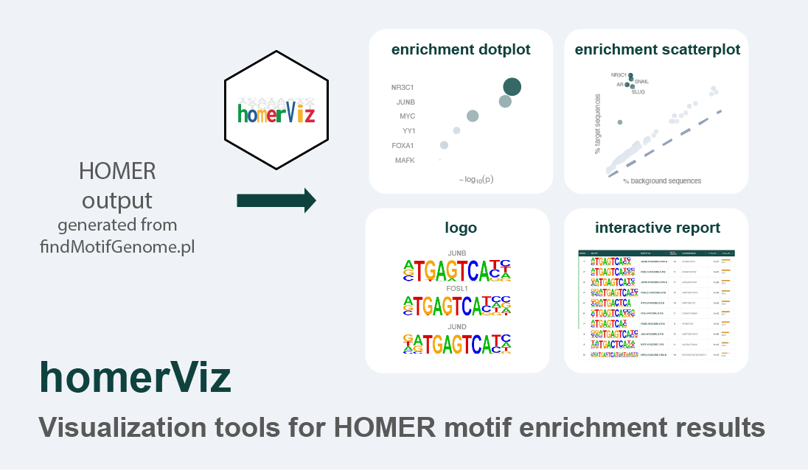
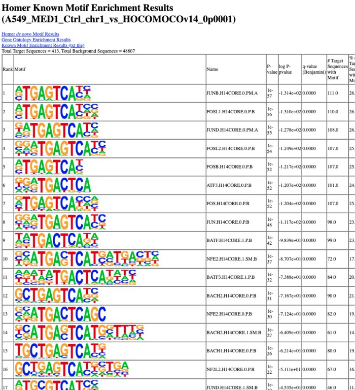
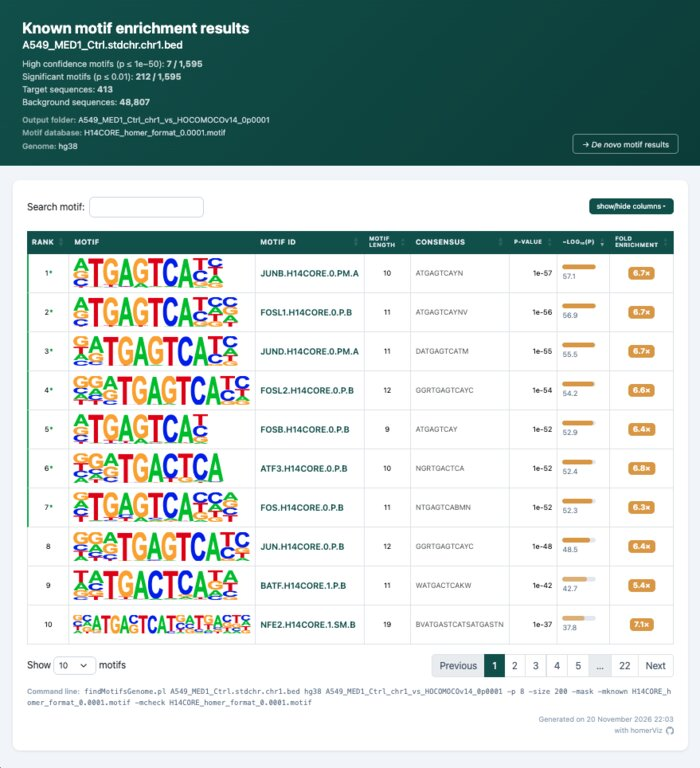
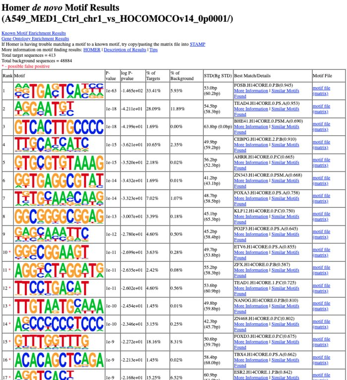
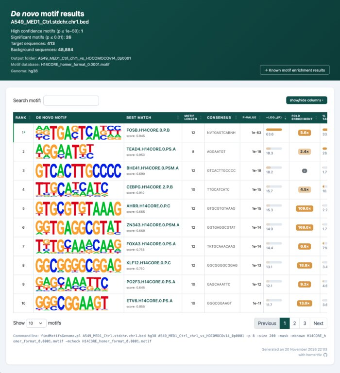

```{r hex-logo, echo=FALSE, out.width="20%", fig.align="center"}

```

```{r setup, include=FALSE}
knitr::opts_chunk$set(
    collapse = TRUE,
    comment = "#>"
)
```

# Introduction

**homerViz** streamlines the exploration and visualization of output from
[HOMER](http://homer.ucsd.edu/homer/) `findMotifsGenome.pl` [@heinz2010], a tool for
motif enrichment analysis widely used in ChIP-seq, ATAC-seq, and related assays.

HOMER produces large output directories containing:

- `knownResults.txt`: enrichment statistics for a library of known motifs.
- `homerResults/motif*.motif`: de novo discovered motifs with statistics.

**homerViz** reads these files into tidy data frames and generates
publication-ready dot plots, scatter plots, and motif logo panels, as well as
interactive HTML reports for exploratory analysis.

<br>
```{r graphical-abstract, echo=FALSE, out.width="100%", fig.align="center"}

```
<br>

# Installation

The homerViz package is available through Bioconductor and GitHub.

You can install it from Bioconductor using:
```{r install-bioconductor, eval=FALSE}
if (!require("BiocManager", quietly = TRUE))
    install.packages("BiocManager")
BiocManager::install("homerViz")
```

To install the development version from GitHub, use:

```{r install-github, eval=FALSE}
# install.packages("pak")  # if not already installed
pak::pak("ckntav/homerViz")

# or, alternatively:
# install.packages("devtools")  # if not already installed
devtools::install_github("ckntav/homerViz")
```
<br>

# Example workflow

This section demonstrates a typical workflow with **homerViz**, from loading
HOMER output to generating clean, publication-ready figures. The examples show
how to work with motif enrichment data.

We start by loading the package:
```{r load_library}
library(homerViz)
```

## 1. Load example HOMER output

The package ships with an example HOMER output directory from a MED1 ChIP-seq
experiment in A549 lung carcinoma cells under control conditions (Ctrl),
matched against HOCOMOCOv14 [@vorontsov2024] at a p-value threshold of 10⁻⁴ using HOMER
v4.11.1. Peaks reproducible across both replicates were kept, and to keep the
dataset lightweight, results are restricted to peaks on *chromosome 1*.

These data originate from @tav2023.

```{r load}
# Load the example path of example dir A549 MED1 ChIP-seq peaks (subset on chr1 for demo)
example_dir <- system.file(
    "extdata",
    "A549_MED1_Ctrl_chr1_vs_HOCOMOCOv14_0p0001",
    package = "homerViz"
)
```

## 2. Reading HOMER output

`read_homer_output()` is the main entry point. It reads both known and de novo
results and returns a `homer_output` object.

```{r read}
homer <- read_homer_output(example_dir)
homer
```

Individual tables are accessible as `$known` and `$denovo`:

```{r table_known}
head(homer$known)
```

```{r table_denovo}
head(homer$denovo)
```

## 3. Interactive HTML reports

`save_homer_html()` generates self-contained HTML reports with interactive,
sortable tables and inline SVG logos. Reports require an internet connection
to load Bootstrap and DataTables assets from CDN.

```{r html, eval=FALSE}
save_homer_html(homer)
```

Known and de novo reports can also be generated independently:

```{r html-individual, eval=FALSE}
save_known_html(homer)
save_denovo_html(homer)
```

Example reports generated from the bundled dataset are available online
(click on a screenshot to open the interactive report):

#### Known motifs

<table style="border-collapse: collapse; width: 100%;">
<tr>
<th style="border: 1px solid #ddd; padding: 8px; text-align: center;">original</th>
<th style="border: 1px solid #ddd; padding: 8px; text-align: center;">homerViz</th>
</tr>
<tr>
<td style="border: 1px solid #ddd; padding: 8px; text-align: center;"><a href="https://ckntav.github.io/homerViz/example/knownResults_original.html" target="_blank"></a></td>
<td style="border: 1px solid #ddd; padding: 8px; text-align: center;"><a href="https://ckntav.github.io/homerViz/example/knownResults_homerViz.html" target="_blank"></a></td>
</tr>
</table>

#### De novo motifs

<table style="border-collapse: collapse; width: 100%;">
<tr>
<th style="border: 1px solid #ddd; padding: 8px; text-align: center;">original</th>
<th style="border: 1px solid #ddd; padding: 8px; text-align: center;">homerViz</th>
</tr>
<tr>
<td style="border: 1px solid #ddd; padding: 8px; text-align: center;"><a href="https://ckntav.github.io/homerViz/example/homerResults_original.html" target="_blank"></a></td>
<td style="border: 1px solid #ddd; padding: 8px; text-align: center;"><a href="https://ckntav.github.io/homerViz/example/homerResults_homerViz.html" target="_blank"></a></td>
</tr>
</table>

## 4. Visualization

**homerViz** provides six plotting functions, organised into three types and
covering both known and de novo motif results:

- dot plot: `plot_known_dotplot()` and `plot_denovo_dotplot()`
- scatter plot: `plot_known_scatter()` and `plot_denovo_scatter()`
- motif logo panel: `plot_known_logos()` and `plot_denovo_logos()`

### a. Dot plot

The dot plot ranks the top-N significant motifs by −log₁₀(p-value). Dot size
and colour both encode fold enrichment. The `top_n` argument controls how many
motifs are displayed (default: `10`).

```{r dotplot-known}
plot_known_dotplot(homer, top_n = 10)
```

```{r dotplot-denovo}
plot_denovo_dotplot(homer)
```

### b. Scatter plot

The scatter plot displays all significant motifs as % target sequences (y-axis)
vs. % background sequences (x-axis). Motifs above the diagonal are enriched
in the target. The `label_top_n` argument controls how many motifs are
automatically labelled, selected by highest −log₁₀(p-value) (default: `5`).

```{r scatter-known}
plot_known_scatter(homer, label_top_n = 5)
```

```{r scatter-denovo}
plot_denovo_scatter(homer)
```

### c. Motif logo panel

`plot_known_logos()` and `plot_denovo_logos()` display the top-N motif logos
alongside enrichment statistics.

These functions accept a `homer_output` object (returned by `read_homer_output()`)
or the individual data frames (`homer$known` / `homer$denovo`). When passing a
data frame directly, the `homer_dir` argument must also be provided so the
function can locate the `.motif` files.

Key arguments:

- `top_n`: number of top motifs to display, ranked by p-value (default: `5`).
- `ncol`: number of columns in the logo grid (default: `1`).
- `show`: which statistics to display next to each logo. Any combination of
  `"pvalue"`, `"fold_enrichment"`, `"pct_target"`, `"pct_background"`.
  All four are shown by default.

```{r logos-known}
plot_known_logos(homer, top_n = 5)
```

```{r logos-known-custom}
plot_known_logos(homer, top_n = 3, show = c("pvalue", "fold_enrichment"))
```

```{r logos-denovo}
plot_denovo_logos(homer)
```

### d. Saving plots

All plotting functions return `ggplot2` (or `patchwork`) objects. Save them to
PDF, PNG or SVG with `saveViz()`, re-exported from the
[gVenn](https://bioconductor.org/packages/gVenn) package [@gvenn].

```{r save-plot}
p <- plot_known_dotplot(homer)
saveViz(p,
        output_dir = tempdir(),
        output_file = "known_dotplot",
        format = "pdf",
        width = 7, height = 6)
```

## 5. Additional arguments

### a. Color scheme

The `color_scheme` argument controls the gradient palette used for fold
enrichment. Available options are:
`"homerViz"` (default), `"red"`, `"blue"`, `"green"`, `"purple"`, and `"viridis"`.

```{r color-schemes, fig.show='hold', out.width='50%'}
plot_known_dotplot(homer, color_scheme = "homerViz") +
    ggplot2::ggtitle('color_scheme = "homerViz" (default)')
plot_known_dotplot(homer, color_scheme = "red") +
    ggplot2::ggtitle('color_scheme = "red"')
plot_known_dotplot(homer, color_scheme = "blue") +
    ggplot2::ggtitle('color_scheme = "blue"')
plot_known_dotplot(homer, color_scheme = "green") +
    ggplot2::ggtitle('color_scheme = "green"')
plot_known_dotplot(homer, color_scheme = "purple") +
    ggplot2::ggtitle('color_scheme = "purple"')
plot_known_dotplot(homer, color_scheme = "viridis") +
    ggplot2::ggtitle('color_scheme = "viridis"')
```

The `color_scheme` parameter is available in four plotting functions:
`plot_known_dotplot()`, `plot_denovo_dotplot()`, `plot_known_scatter()`,
and `plot_denovo_scatter()`.

### b. Size by fold enrichment

By default, all points have the same size (`size_by_fe = FALSE`). Setting
`size_by_fe = TRUE` encodes fold enrichment in point size:

```{r scatter-size-by-fe, fig.show='hold', out.width='50%'}
plot_known_scatter(homer, label_top_n = 5, size_by_fe = FALSE) +
    ggplot2::ggtitle("size_by_fe = FALSE (default)")
plot_known_scatter(homer, label_top_n = 5, size_by_fe = TRUE) +
    ggplot2::ggtitle("size_by_fe = TRUE")
```

The `size_by_fe` parameter is available in `plot_known_scatter()` and
`plot_denovo_scatter()`.

### c. P-value threshold

All dot plot and scatter plot functions accept a `p_cutoff` argument to filter
motifs by significance before plotting (default: `0.05`). Only motifs with
p-value below this threshold are included.

```{r p-cutoff, fig.show='hold', out.width='50%'}
plot_known_dotplot(homer)
plot_known_dotplot(homer, p_cutoff = 1e-50)
```

The `p_cutoff` parameter is available in `plot_known_dotplot()`,
`plot_denovo_dotplot()`, `plot_known_scatter()`, and `plot_denovo_scatter()`.

<br>

# Session info

This vignette was built with the following R session:
```{r session-info}
sessionInfo()
```

# References
